# agent-hangar

[](https://github.com/gaku1023/agent-hangar/releases/latest)
[](#入れる)
[](LICENSE)

Claude Code、Codex、opencode のセッションを、プロジェクトごとに束ねて見渡すデスクトップアプリです。
いくつもの会話を同時に走らせ、手が要るものにだけ戻れます。


**入れる**：[Releases](https://github.com/gaku1023/agent-hangar/releases/latest) から macOS の dmg か Windows のインストーラを取ります。
先に Node 22.14 以上と tmux（Windows は psmux）が要ります。
手順は「[入れる](#入れる)」の節のとおりです。

## 始める

<table>
  <tr>
    <td width="60%">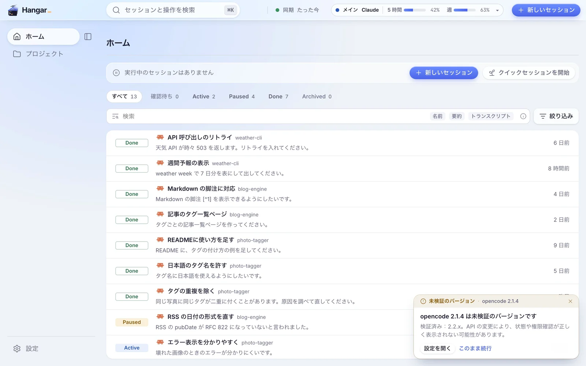</td>
    <td>
      <b>どの会話も同じ所から起こす</b><br><br>
      プロジェクトとエージェントを選び、初期プロンプトを書いて起動します。
      <code>/</code> でスキルやコマンドを、<code>@</code> でファイルを差し込めます。
    </td>
  </tr>
  <tr>
    <td>
      <b>3 つのエージェントを並べる</b><br><br>
      Claude Code、Codex、opencode の会話を、同じ画面で並べて動かせます。
      Codex と opencode はベータで、設定の「連携」で有効にすると使えます。
    </td>
    <td width="60%">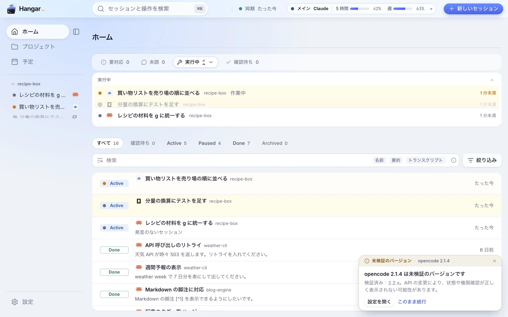</td>
  </tr>
  <tr>
    <td width="60%"></td>
    <td>
      <b>画像を落として頼む</b><br><br>
      スクリーンショットを端末に落とすと、そのパスが入ります。
      続けて頼みごとを書けば、エージェントが画像を読んで直します。
    </td>
  </tr>
</table>

## 見渡す

<table>
  <tr>
    <td>
      <b>手が要るものだけ知らせる</b><br><br>
      会話が許可を求めて止まると、ホームの「要対応」とサイドバーに印が出ます。
      開いて答えれば、また動き出します。
    </td>
    <td width="60%">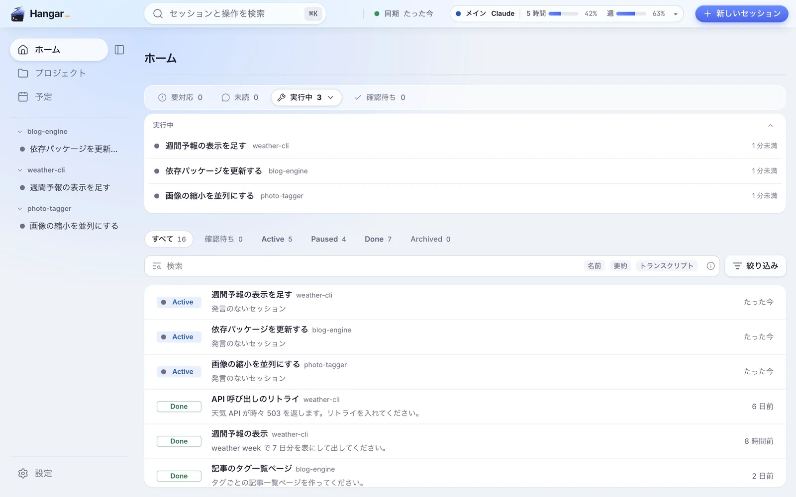</td>
  </tr>
  <tr>
    <td width="60%">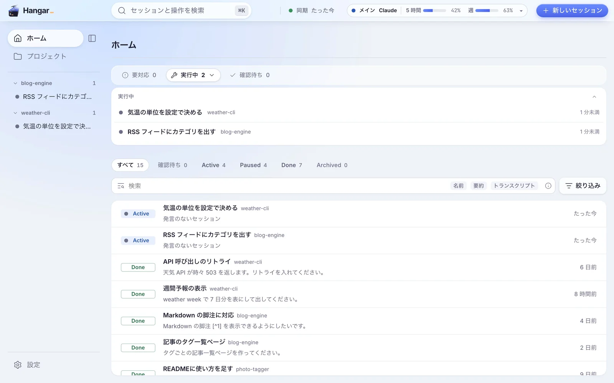</td>
    <td>
      <b>並べて動かす</b><br><br>
      サイドバーの会話を ⌥ を押しながら開くと、画面を分けて並べられます。
      境目はドラッグで動かせます。
    </td>
  </tr>
  <tr>
    <td>
      <b>使用量を見る</b><br><br>
      Claude Code と Codex の、5 時間と週の窓ごとの使用量をヘッダーで見られます。
      アカウントを複数登録して切り替えることもできます。
    </td>
    <td width="60%">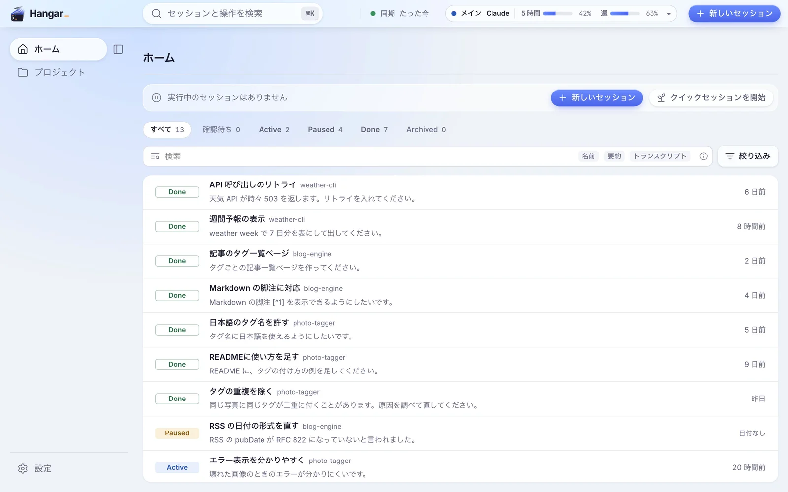</td>
  </tr>
</table>

## さかのぼる

<table>
  <tr>
    <td width="60%">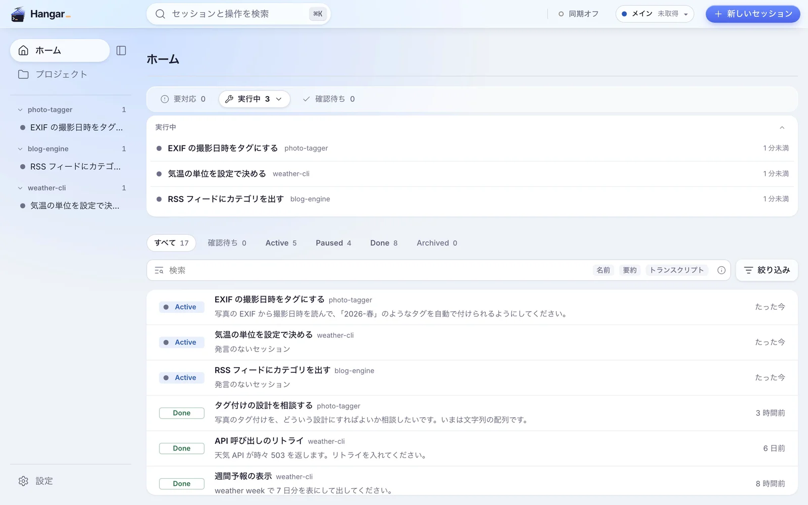</td>
    <td>
      <b>過去の会話を探す</b><br><br>
      名前、要約、トランスクリプトの中身から探せます。
      開いた会話は、右欄のターンの目次で読みたい所へ飛べます。
    </td>
  </tr>
  <tr>
    <td>
      <b>⌘K で移る</b><br><br>
      会話の名前を数文字打てば、そこへ移れます。
      新しいセッションや設定などの操作も、同じ所から呼べます。
    </td>
    <td width="60%">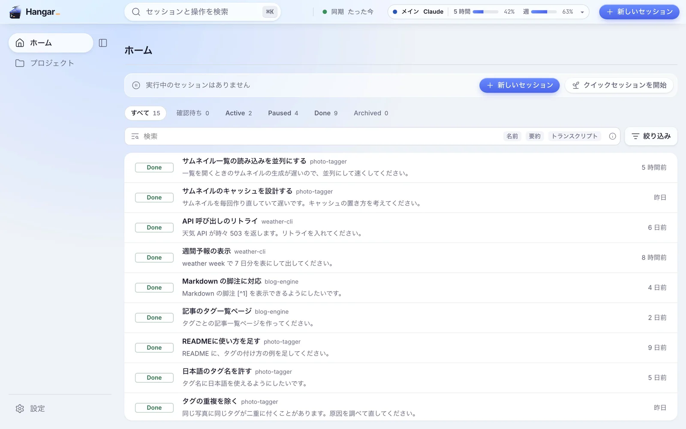</td>
  </tr>
</table>

## 片付ける

hangar を MCP サーバとして登録すると、Claude Code が自分で会話の要約や状態を書き込みます。

<table>
  <tr>
    <td width="60%">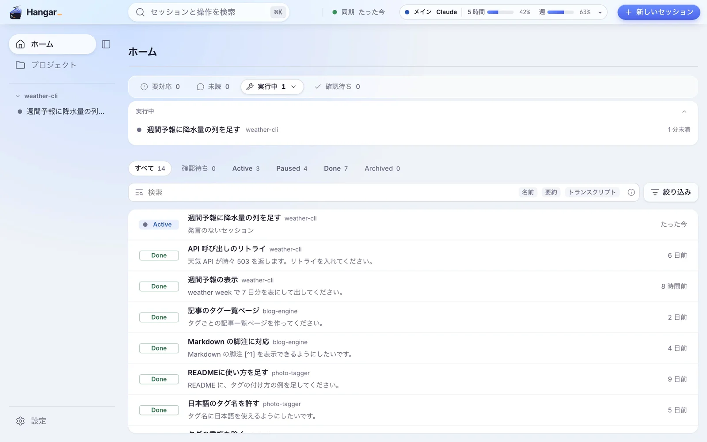</td>
    <td>
      <b>終わった会話を Done にする</b><br><br>
      仕事を終えた Claude Code が、要約を書いて Done を提案します。
      確定すると、その会話はプロジェクトの Done の段に移ります。
    </td>
  </tr>
  <tr>
    <td>
      <b>TODO を消し込む</b><br><br>
      プロジェクトの TODO を Claude Code が「済んだ」と提案し、根拠を添えます。
      チェックを入れるのは利用者です。
    </td>
    <td width="60%">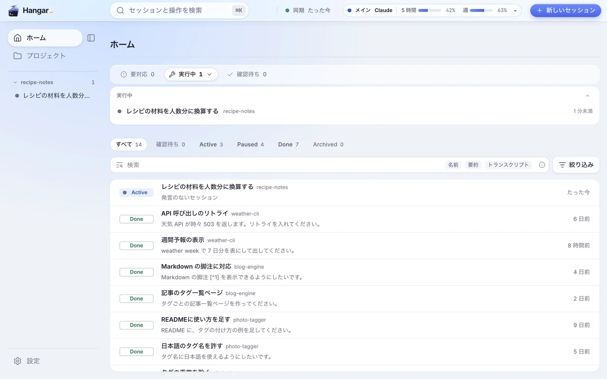</td>
  </tr>
</table>

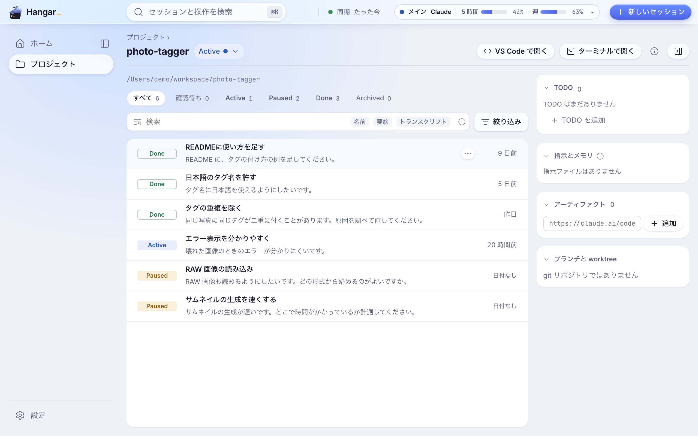

## 外から頼む

<table>
  <tr>
    <td width="60%">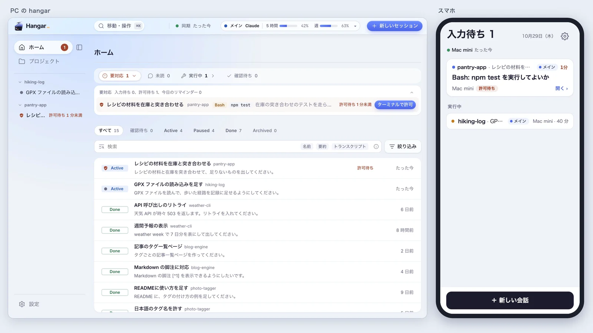</td>
    <td>
      <b>スマホから会話を起こす（試験的）</b><br><br>
      自分の Cloudflare アカウントで PC 間の同期を設定すると、スマホのブラウザで受信箱を見て、PC に新しい会話を頼めます。
      同期は上級者向けのベータです。
      始め方は <a href="docs/cloud-sync.md">docs/cloud-sync.md</a> にあります。
    </td>
  </tr>
</table>

## 入れる

配布物は [Releases](https://github.com/gaku1023/agent-hangar/releases/latest) に置いています。
画面は英語にも切り替えられます。

| | macOS | Windows |
|---|---|---|
| 対象 | macOS 13 以降、Apple silicon | Windows 11（x64） |
| 配布物 | `Hangar-vX.Y.Z-macos-arm64.dmg` | `Hangar-vX.Y.Z-windows-x64-setup.exe` |
| 先に入れるもの | Node 22.14 以上、tmux、`claude` | Node 22.14 以上、psmux、`claude` |

アプリは Node を同梱していないので、先に入れておきます。
macOS では Homebrew で Node と tmux をまとめて入れられます。

```sh
brew install node tmux
```

`claude` の入れ方は Claude Code の案内に従ってください。

macOS では自作の証明書で署名しているので、初めて開くときに「"Hangar" は開いていません」という警告が出ます。
Windows のインストーラは署名していないので、SmartScreen が止めます。
警告の越え方、psmux の入れ方、Node の探し方は [docs/install.md](docs/install.md) にあります。

## 詳しい文書

- [docs/install.md](docs/install.md)：入れ方の細部、v0.1.0 からの移行、zip から入れる手順、psmux。
- [docs/usage.md](docs/usage.md)：初日にすること、使い方、ショートカット。
- [docs/cloud-sync.md](docs/cloud-sync.md)：クラウド同期の始め方と割り切り、スマホ（試験的）。
- [docs/files-and-network.md](docs/files-and-network.md)：hangar が書くファイルと、通信先。
- [docs/troubleshooting.md](docs/troubleshooting.md)：困ったとき。
- [docs/development.md](docs/development.md)：clone して動かす手順、試験、インストーラを作る手順。README の画像の撮り方は [scripts/readme-shots/README.md](scripts/readme-shots/README.md)。
- [docs/verification.md](docs/verification.md)：実物で確かめた範囲の記録。
- [docs/release.md](docs/release.md)：リリースの手順。
- [docs/signing.md](docs/signing.md)：署名の仕組み。
- [docs/design.md](docs/design.md)：設計。実装計画は `docs/plans/` にあります。

## 商標

agent-hangar は非公式のツールです。
Anthropic からも、opencode の開発元からも、OpenAI からも、承認や支援を受けていません。
Claude、Claude Code と、その起動画面のキャラクター（Clawd）は Anthropic に帰属します。
opencode の名前とロゴは、opencode の開発元に帰属します。
OpenAI と Codex の名前とアイコンは OpenAI に帰属します。
その他の商標は、それぞれの権利者に帰属します。
一覧、サイドバー、ターミナルのタブのアイコンは、どのエージェントの会話かを見分けるためだけに使っています。
