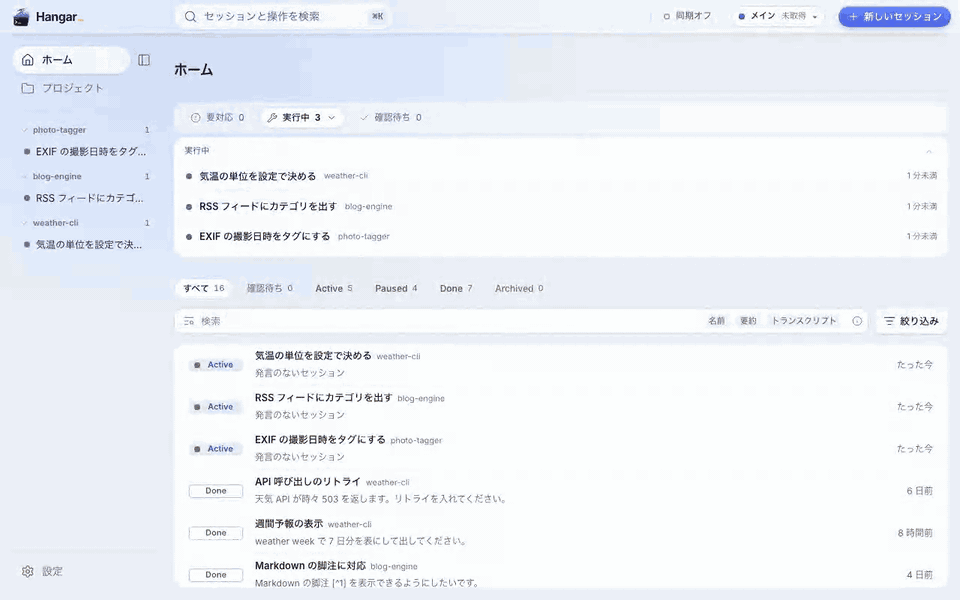
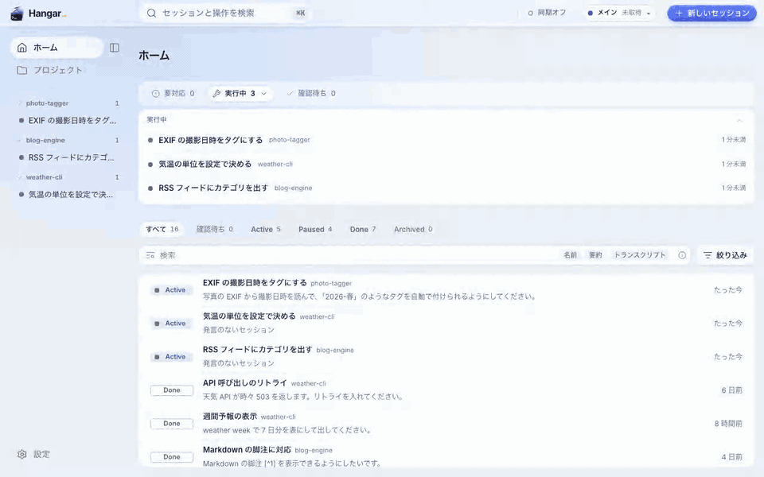
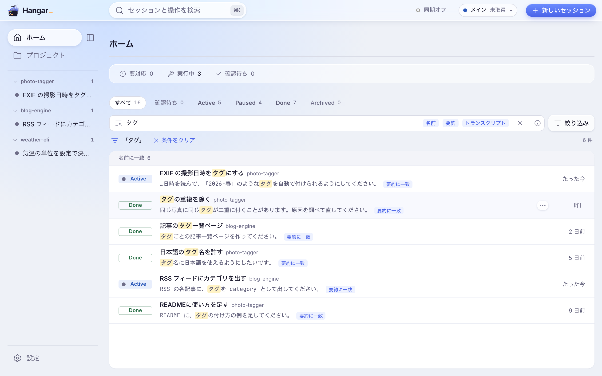

# agent-hangar

[](https://github.com/gaku1023/agent-hangar/releases/latest)
[](#入れる)
[](LICENSE)

Claude Code、Codex、opencode のセッションを、プロジェクトごとに束ねて見渡すデスクトップアプリです。
Codex と opencode はベータで、設定の「連携」で有効にすると使えます。
画面は英語にも切り替えられます。



## できること

<table>
  <tr>
    <td width="33%"></td>
    <td width="33%"></td>
    <td width="33%"></td>
  </tr>
  <tr>
    <td><b>束ねる</b><br>会話をプロジェクトごとにまとめ、同じ画面で TODO とメモも書けます。</td>
    <td><b>見渡す</b><br>会話を画面の左右や上下に並べて開けます。</td>
    <td><b>さかのぼる</b><br>過去の会話を検索して読み返し、続きから再開できます。</td>
  </tr>
</table>

ほかに次のことができます。

- hangar を MCP サーバとして Claude Code に登録すると、Claude Code から過去の会話を探して読めます。
- Claude Code のアカウントを複数登録し、ヘッダーから切り替えられます。
- 自分の Cloudflare アカウントを使い、自分の PC の間で会話と設定を同期できます（上級者向けのベータ）。
  同期を設定した PC があれば、スマホのブラウザで受信箱を見て、会話を起こせます（試験的）。

## 入れる

配布物は [Releases](https://github.com/gaku1023/agent-hangar/releases/latest) に置いています。

| | macOS | Windows |
|---|---|---|
| 対象 | macOS 13 以降、Apple silicon | Windows 11（x64） |
| 配布物 | `Hangar-vX.Y.Z-macos-arm64.dmg` | `Hangar-vX.Y.Z-windows-x64-setup.exe` |
| 先に入れるもの | Node 22.14 以上、tmux、`claude` | Node 22.14 以上、psmux、`claude` |

アプリは Node を同梱していないので、先に入れておきます。
macOS では Homebrew で Node と tmux をまとめて入れられます。

```sh
brew install node tmux
```

`claude` の入れ方は Claude Code の案内に従ってください。

macOS では自作の証明書で署名しているので、初めて開くときに「"Hangar" は開いていません」という警告が出ます。
Windows のインストーラは署名していないので、SmartScreen が止めます。
警告の越え方、psmux の入れ方、Node の探し方は [docs/install.md](docs/install.md) にあります。

## 詳しい文書

- [docs/install.md](docs/install.md)：入れ方の細部、v0.1.0 からの移行、zip から入れる手順、psmux。
- [docs/usage.md](docs/usage.md)：初日にすること、使い方、ショートカット。
- [docs/cloud-sync.md](docs/cloud-sync.md)：クラウド同期の始め方と割り切り、スマホ（試験的）。
- [docs/files-and-network.md](docs/files-and-network.md)：hangar が書くファイルと、通信先。
- [docs/troubleshooting.md](docs/troubleshooting.md)：困ったとき。
- [docs/development.md](docs/development.md)：clone して動かす手順、試験、インストーラを作る手順。
- [docs/verification.md](docs/verification.md)：実物で確かめた範囲の記録。
- [docs/release.md](docs/release.md)：リリースの手順。
- [docs/signing.md](docs/signing.md)：署名の仕組み。
- [docs/design.md](docs/design.md)：設計。実装計画は `docs/plans/` にあります。

## 商標

agent-hangar は非公式のツールです。
Anthropic からも、opencode の開発元からも、OpenAI からも、承認や支援を受けていません。
Claude、Claude Code と、その起動画面のキャラクター（Clawd）は Anthropic に帰属します。
opencode の名前とロゴは、opencode の開発元に帰属します。
OpenAI と Codex の名前とアイコンは OpenAI に帰属します。
その他の商標は、それぞれの権利者に帰属します。
一覧、サイドバー、ターミナルのタブのアイコンは、どのエージェントの会話かを見分けるためだけに使っています。
